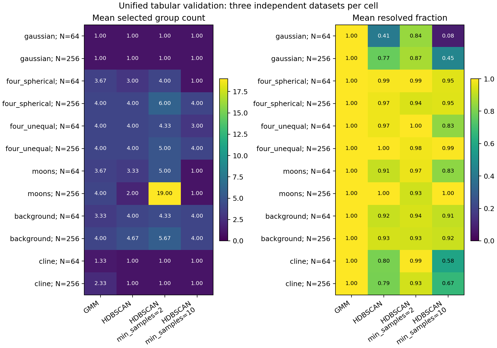

# Unified tabular analysis: checkpoint validation

The unified entry point completed all **672 planned main pipeline runs**:
144 point analyses, 480 native resampling refits and 48 exact standalone point
replays. All 36 independent synthetic datasets and all 216 pairwise comparisons
passed independent artifact audits. The separate 88-run preflight also passed.
No model arm or resampling draw failed; no failed fit was replaced. This validates
composition of the existing models, rather than introducing a new clustering
method or improving their scientific performance.

The study used Gaussian controls, four spherical groups, unequal-variance groups,
noisy moons, groups with background noise and continuous clines, at N=64/256 with
three datasets per cell. Four configurations were frozen before generation:
full-covariance PCA/GMM with BIC, and PCA/HDBSCAN with min_samples 5/2/10. Other
settings were unchanged. All analyses used the same declared two continuous
traits, standardized scaling, two PCs and source cohort per observation.

Each cell shows the mean of three datasets. A mean group count can be fractional;
it is not a selected partition. HDBSCAN resolution and fragmentation depend on
its density settings. The comparison report therefore retains each partition,
noise/unresolved coverage and label-invariant agreement on the jointly resolved
intersection. Agreement is conditional and cannot substitute for coverage or
biological validation. These small descriptive cells do not justify choosing a
best model or changing any default.

All 48 independently invoked standalone point replays matched native assignments
and fitted numerical arrays exactly. Independent audits reconstructed raw inputs
from all 38 frozen preflight/main seed declarations, checked source/unit order
and hashes, recomputed PCA parameters and projections from raw traits, checked
selected GMM likelihood/BIC/membership, and recalculated pairwise disagreement
and ARI independently. Separate inclusion audits reconstructed GMM bootstrap/OOB
and HDBSCAN subsampling denominators from native retained records. GMM native
bootstrap records retain labels/candidates and denominators, rather than every
replicate's fitted covariance/PCA arrays; the new wrapper preserves that contract.

The first preflight attempt failed at runner startup on macOS before any scientific
fits because the multiprocessing script lacked a main guard. The guard was fixed
and the startup record retained. The subsequent audited preflight projected about
696 MiB under its conservative storage rule, exceeding the original 512 MiB cap.
The user approved a budget-only amendment to 1 GiB. The failed gate, original
settings, approval record and both runtime snapshots remain local. No seeds,
model settings, datasets or scientific fit counts changed for that amendment.

Detailed evidence remains local. Published [small summaries](../examples/tabular-analysis/results/summary.json),
[model aggregates](../examples/tabular-analysis/results/models.json) and
[conditional comparisons](../examples/tabular-analysis/results/comparisons.json)
contain no specimen data or fitted/resampling arrays. The report can be reproduced
with `examples/tabular-analysis/report.py` against the retained local evidence.

Defaults and historical p-values are unchanged. No new p-value, winning model,
consensus species partition, empirical species accuracy or general performance
guarantee is claimed. Sampling/reference gates on empirical datasets remain in
force. See the [user guide](tabular-analysis.md) for the supported input boundaries
and distinctions among posterior membership, density strength and stability.
