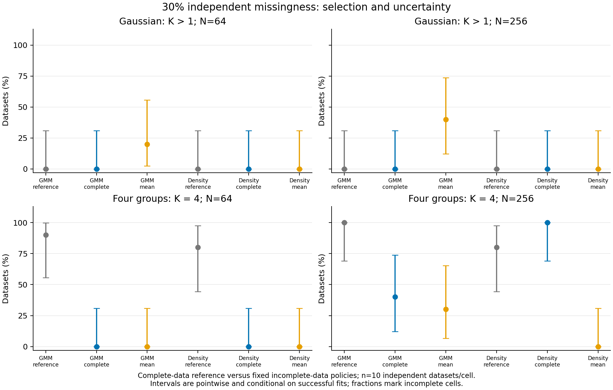

# Missing-data validation findings

Observed-feature mean imputation retained more specimens but could distort group
geometry, increase Gaussian-control partitioning and weaken generating-group
recovery. This result supports a sensitivity interface with explicit limits;
it does not support automatically replacing the complete-data default.

The frozen main study retained all 60 independent complete datasets, five paired
masks per dataset, 1,320 point pipelines, 480 native refits and 36 exact point
replays: 1,836 planned main slots. The separate full-settings preflight retained
408 slots. Independent audits verified raw generation/masks, every training fit,
mixture likelihood/BIC, density results on audited PC scores, projections, seeds,
coverage/support denominators and replay arrays. Main point and draw failures
were both zero; all requested fits and replays completed without replacement.

The three laws were a correlated nonsingular Gaussian control, four spherical
groups and noisy moons, embedded into four measured features with small independent
jitter. Each law/sample-size cell contains only ten independent datasets. Masks
and bootstrap/subsample draws are repeated measurements, not extra independent
observations. Complete-data simulation references never supplied hidden values
to an incomplete-data fit. No empirical data or molecular labels were analyzed.

## Retention versus recovery

With 30% independent cell missingness, complete-case retention averaged roughly
24–26% across the six law/sample-size cells; mean treatment retained roughly
99%, excluding fully unobserved rows. Four features explain the large loss:
the expected complete fraction is 0.7^4 = 24.01%, whereas the fraction with any
observed feature is 1 - 0.3^4 = 99.19%. Retaining a row does not recover its unknown
measurements, preserve distances or establish an independent sampling unit.

The following table reports selection of exactly four components/groups under
the four-group law. Parentheses are pointwise exact 95% intervals across ten
datasets, not species-support intervals or simultaneous comparisons.

| N | Model | Complete-data reference | Complete cases, 30% missing | Mean, 30% missing |
| ---: | --- | --- | --- | --- |
| 64 | GMM | 9/10 (55.5–99.7%) | 0/10 (0.0–30.8%) | 0/10 (0.0–30.8%) |
| 64 | HDBSCAN | 8/10 (44.4–97.5%) | 0/10 (0.0–30.8%) | 0/10 (0.0–30.8%) |
| 256 | GMM | 10/10 (69.2–100.0%) | 4/10 (12.2–73.8%) | 3/10 (6.7–65.2%) |
| 256 | HDBSCAN | 8/10 (44.4–97.5%) | 10/10 (69.2–100.0%) | 0/10 (0.0–30.8%) |

At N=256, the mean-filled HDBSCAN analyses selected one group in all ten
30%-missing four-group datasets; complete cases selected four in all ten.
GMM selected four in 3/10 mean-filled datasets and 4/10 complete-case datasets,
versus 10/10 complete-data references. These small paired cells are descriptive;
they do not establish a generally superior policy. At N=64 neither incomplete-
data policy selected four groups in this particular cell.

The retained aggregate includes resolved-unit ARI and loss relative to the
complete-data reference on the *same resolved units*. That separates geometric
loss from specimen removal. Resolved ARI can look high after noise/exclusion
removes difficult or entire generating groups; coverage and selected K must be
read alongside it. Absolute BIC was not compared across cohorts/preprocessing.

## Gaussian-control partitioning

These are counts of K>1 under a single Gaussian raw-data law, not calibrated
significance-test false-positive rates. Each entry is out of ten datasets.

| N | Model after mean filling | 10% random | 30% random | Observed-trait-dependent | Value-dependent stress | Pattern stress |
| ---: | --- | ---: | ---: | ---: | ---: | ---: |
| 64 | GMM | 0 | 2 | 1 | 1 | 1 |
| 64 | HDBSCAN | 0 | 0 | 0 | 0 | 0 |
| 256 | GMM | 0 | 4 | 9 | 5 | 1 |
| 256 | HDBSCAN | 0 | 0 | 3 | 0 | 0 |

At N=256, observed-trait-dependent mean filling produced K>1 in 9/10 GMM and
3/10 HDBSCAN controls; the latter selected nine groups in those three datasets.
The missingness mechanisms are known simulator laws, not empirically inferred
amphipod mechanisms. Feature-dependent masks can correlate with generating groups
even though the sampler receives no labels. This is evidence of sensitivity to
preprocessing and missingness, without a species-boundary interpretation.

## Stability and scope

All 480 requested native draws succeeded. Their K distributions, coassignment,
GMM exact-set recovery/OOB and HDBSCAN inclusion/noise denominators remain local
in native artifacts. A compact public K-frequency ledger keeps the 48 arm/dataset
records separate. K frequency is not cluster recovery; no support values are
pooled across families. All these quantities are conditional on the observed mask,
fixed imputation policy and numerical settings. Single imputation does not
propagate missing-value uncertainty, and stability can support a wrong partition.

The unchanged density settings still had weak noisy-moons recovery. No density
parameter, PC count, mask, threshold, seed or model default was tuned to these
outcomes. The study does not justify species probabilities, significance,
a universal missing-data policy or changes to empirical cohort/sampling gates.

The independent report audit recomputed all 132 aggregate cells, exact intervals,
retention/failure denominators and native stability counts without new pipeline
fits. Original values and masks, failed-test evidence and all study artifacts
stay local under the approved 4 GiB cap. Only code/docs, invented small fixtures,
figures and aggregate findings are public. Historical p-values, legacy
serialization and defaults remain unchanged. Python support is 3.11/3.12;
no empirical clustering or author contact occurred.
