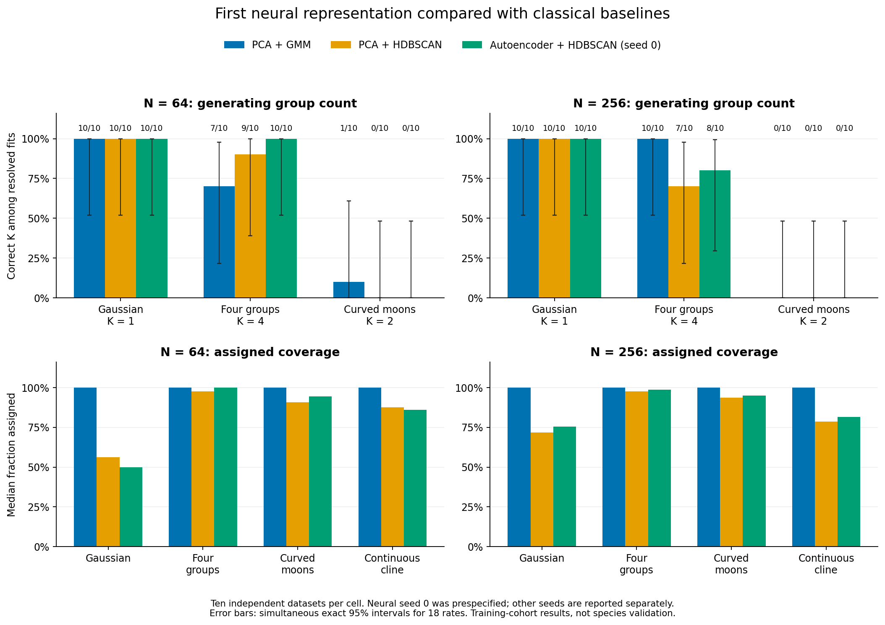

# First neural-model validation findings

The completed checkpoint adds an opt-in CPU autoencoder/HDBSCAN workflow. It preserves the existing classical models, defaults, schemas and historical p-values. The new groups are transductive density hypotheses, with no species-significance claim.

## Completed execution

The separate 120-workflow preflight passed with zero failures. The main study attempted all 1,210 planned workflows across 80 fresh datasets, including paired unit subsamples and ten exact point replays. The main audit records 0 failed workflows; none were replaced. Reference labels were evaluated only after fitting. The numerical audit and full detailed evidence remain local. Only small aggregates and figures are published.

## Group-count recovery and coverage

Entries are correct-K selections / resolved datasets. Each cell requested ten datasets. Read failure bounds and the exact pointwise/simultaneous intervals in the public summary. Seed zero was chosen before generation, not selected as a winning neural initialization.

| Law | N | PCA/GMM | PCA/HDBSCAN | Autoencoder/HDBSCAN, seed 0 |
|---|---:|---:|---:|---:|
| Gaussian | 64 | 10/10 | 10/10 | 10/10 |
| Gaussian | 256 | 10/10 | 10/10 | 10/10 |
| Four groups | 64 | 7/10 | 9/10 | 10/10 |
| Four groups | 256 | 10/10 | 7/10 | 8/10 |
| Curved moons | 64 | 1/10 | 0/10 | 0/10 |
| Curved moons | 256 | 0/10 | 0/10 | 0/10 |

Correct K and accurate assignment are separate. Full-unit ARI treats each noise observation as a separate unresolved singleton; assigned-only ARI must be read with coverage. Gaussian extra-group selection is descriptive overpartitioning, not a calibrated significance-test false-positive rate. The continuous cline has no correct K.

The neural workflow selected four groups in all ten N=64 four-group datasets at each of the three initialization seeds. At N=256 it selected four groups in eight of ten datasets at every seed, while PCA/GMM selected four in all ten. None of the neural seeds recovered the two moons groups. Gaussian K=1 selections also leave many observations unassigned: seed zero's median assigned coverage was 50.0% at N=64 and 75.4% at N=256. Seed 202 selected two groups in one N=256 Gaussian dataset. These results support a working neural alternative, without establishing improved performance across geometries or seeds.

| Law | N | Arm | Median full-unit ARI | Median assigned coverage |
|---|---:|---|---:|---:|
| Gaussian | 64 | PCA + GMM | 1.000 | 100.0% |
| Gaussian | 64 | PCA + HDBSCAN | 0.000 | 56.2% |
| Gaussian | 64 | Autoencoder + HDBSCAN (seed 0) | 0.000 | 50.0% |
| Gaussian | 256 | PCA + GMM | 1.000 | 100.0% |
| Gaussian | 256 | PCA + HDBSCAN | 0.000 | 71.7% |
| Gaussian | 256 | Autoencoder + HDBSCAN (seed 0) | 0.000 | 75.4% |
| Four groups | 64 | PCA + GMM | 1.000 | 100.0% |
| Four groups | 64 | PCA + HDBSCAN | 0.938 | 97.7% |
| Four groups | 64 | Autoencoder + HDBSCAN (seed 0) | 0.990 | 100.0% |
| Four groups | 256 | PCA + GMM | 0.995 | 100.0% |
| Four groups | 256 | PCA + HDBSCAN | 0.953 | 97.5% |
| Four groups | 256 | Autoencoder + HDBSCAN (seed 0) | 0.977 | 98.6% |
| Curved moons | 64 | PCA + GMM | 0.442 | 100.0% |
| Curved moons | 64 | PCA + HDBSCAN | 0.006 | 90.6% |
| Curved moons | 64 | Autoencoder + HDBSCAN (seed 0) | 0.000 | 94.5% |
| Curved moons | 256 | PCA + GMM | 0.361 | 100.0% |
| Curved moons | 256 | PCA + HDBSCAN | 0.001 | 93.6% |
| Curved moons | 256 | Autoencoder + HDBSCAN (seed 0) | -0.000 | 94.9% |
| Continuous cline | 64 | PCA + GMM | not defined | 100.0% |
| Continuous cline | 64 | PCA + HDBSCAN | not defined | 87.5% |
| Continuous cline | 64 | Autoencoder + HDBSCAN (seed 0) | not defined | 85.9% |
| Continuous cline | 256 | PCA + GMM | not defined | 100.0% |
| Continuous cline | 256 | PCA + HDBSCAN | not defined | 78.5% |
| Continuous cline | 256 | Autoencoder + HDBSCAN (seed 0) | not defined | 81.4% |

## Initialization and conditional subsampling

The public summary retains seeds 0, 101 and 202 rather than promoting the best one. Initialization agreement is conditional on jointly non-noise units, with its coverage. A degenerate constant partition can have ARI one without demonstrating recovered structure.

Twenty shared 80% whole-unit subsamples were fitted on the first observation in each of eight cells, for every arm. That is one stability example per cell, not ten independent stability datasets. Every draw refits raw preprocessing, representation and clustering. Native coassignment uses successful pair inclusions, keeps failures and bounds, and never assigns absent observations. The within-point statistic is pair-inclusion-weighted coassignment among original positive-cluster pairs; it is not species support or external predictive accuracy. The GMM study subsamples do not replace its ordinary bootstrap.

## Interpretation limits

This is a small, frozen pilot with ten independent datasets per cell and one architecture/training budget. Reconstruction is in-cohort training MSE, not an external prediction score. Neural latent standardization differs from native PCA-score scaling, so the experiment compares whole workflows. No configuration, seed or covariance family is automatically selected or promoted. Missingness, genomic/shape/multimodal neural adapters, anatomical landmark learning and significance calibration remain later work. No SPARUS or other empirical fitting was performed and nobody was contacted.

See the [model and API](tabular-neural.md), [fixed protocol](tabular-neural-study.md), [small results](../examples/neural/results/summary.json) and [independent audit](../examples/neural/results/independent-audit.json).
