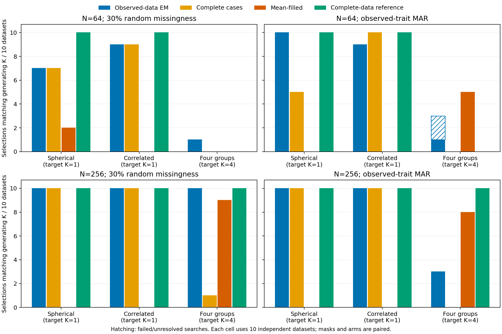

# Observed-data GMM: bounded missing-data validation

This point-only checkpoint fits incomplete continuous observations directly,
without PCA or deterministic completion in the observed-data arm. It preserves
all existing workflows, defaults and historical p-values. No empirical species
accuracy, significance calibration or bootstrap claim follows from this study.

## Frozen design and correctness

Sixty independent four-feature datasets cover spherical/correlated Gaussian
controls and an equiprobable four-group Gaussian mixture at N=64/256, ten per
law/sample-size cell. Each has paired 10%/30% random, observed-trait MAR,
hidden-value MNAR stress and structured masks. Four arms share the same training
transform, full-covariance constrained solver, ten starts and K=1..4 BIC search:
observed-data EM, complete cases, mean-filled data and a complete-data reference.
The fixed covariance lower bound is 1e-4 in training-scaled units.

There were 1,200 main point searches and 24 exact replays after a separate
144-search audited preflight. Each raw dataset also has 2,048 independent external
units, with new paired masks, for frozen-model prediction. External outcomes and
generating labels never determine fitting, initialization or selection.

The independent audit reconstructs raw laws/masks, scaling, conditional-moment
updates, densities, memberships, covariance constraints, convergence, candidate
criteria, seeds, selection, external predictions and exact replays. A write-once
reporting error and a scalar-array error in the independent reference generator
were repaired with regression tests. Their logs and original freezes remain
local. All original preflight fits were preserved; no search was replaced, no
scientific setting or generator/kernel changed, and the main run began only after
the complete preflight and measured storage gate passed.

The main audit checked 47,330 retained start fits across all 1,224 searches. There were 4 unresolved main point searches out of 1,200; failed starts are retained separately.

## Unresolved searches

| Law | N | Replicate | Mask | Arm | Reason |
|---|---:|---:|---|---|---|
| four_groups | 64 | 5 | mar | observed | No converged K=4 candidate; selection withheld |
| four_groups | 64 | 8 | mar | observed | No converged K=4 candidate; selection withheld |
| spherical | 64 | 4 | pattern | observed | No converged K=4 candidate; selection withheld |
| spherical | 64 | 8 | pattern | complete_case | Too few informative independent units |

These outcomes are retained without replacement. Failed feasible searches are not recoded as K=1.

## Gaussian controls: selecting more than one component

Entries are K>1 selections / successful searches. Unresolved searches, if any,
are stated separately. This is model-selection overpartitioning under a known
single-Gaussian law, not a calibrated significance-test false-positive rate.
Each cell has ten requested datasets; the complete five-mask tables, exact
pointwise intervals and failure bounds are in the public small summary.

| Law | N | Mask | Observed EM | Complete cases | Mean-filled | Complete reference |
|---|---:|---|---:|---:|---:|---:|
| spherical | 64 | mcar30 | 3/10 | 3/10 | 8/10 | 0/10 |
| spherical | 64 | mar | 0/10 | 5/10 | 10/10 | 0/10 |
| spherical | 256 | mcar30 | 0/10 | 0/10 | 10/10 | 0/10 |
| spherical | 256 | mar | 0/10 | 0/10 | 10/10 | 0/10 |
| correlated | 64 | mcar30 | 1/10 | 1/10 | 10/10 | 0/10 |
| correlated | 64 | mar | 1/10 | 0/10 | 10/10 | 0/10 |
| correlated | 256 | mcar30 | 0/10 | 0/10 | 10/10 | 0/10 |
| correlated | 256 | mar | 0/10 | 0/10 | 10/10 | 0/10 |

## Four generating groups: selecting four components

Entries are K=4 selections / successful searches. Correct K and agreement with
generating labels are separate outcomes. Coverage and retained/common-unit ARI
must accompany comparisons involving complete cases.

| N | Mask | Observed EM | Complete cases | Mean-filled | Complete reference |
|---:|---|---:|---:|---:|---:|
| 64 | mcar10 | 0/10 | 0/10 | 0/10 | 0/10 |
| 64 | mcar30 | 1/10 | 0/10 | 0/10 | 0/10 |
| 64 | mar | 1/8; 2 unresolved | 0/10 | 5/10 | 0/10 |
| 64 | mnar | 5/10 | 0/10 | 2/10 | 0/10 |
| 64 | pattern | 3/10 | 0/10 | 3/10 | 0/10 |
| 256 | mcar10 | 10/10 | 10/10 | 5/10 | 10/10 |
| 256 | mcar30 | 10/10 | 1/10 | 9/10 | 10/10 |
| 256 | mar | 3/10 | 0/10 | 8/10 | 10/10 |
| 256 | mnar | 7/10 | 1/10 | 9/10 | 10/10 |
| 256 | pattern | 10/10 | 1/10 | 5/10 | 10/10 |

## Coverage and prediction

Complete cases discard every row with any selected missing value. Observed EM
and mean filling retain every row with at least one observed feature. At 30%
independent missingness across four features, theoretical complete-case retention
is 24.01%; informative-row retention is 99.19%. Realized retention, retained-unit
ARI and common-unit comparison with the complete reference are reported in the
small summary. Conditional agreement can look favorable after losing units or
groups; it does not substitute for population-wide recovery.

Predictive comparisons use identical independent evaluation rows and observed
coordinates, with row-specific transformation Jacobians in original feature
units. Complete-data prediction is reported separately. No absolute training
likelihood/BIC is compared across different cohorts or coordinate masks.

Observed-minus-mean median held-out marginal log-density gains were positive in 26/30 scenario/mask cells (range -6.193 to 0.8747 log-density units per evaluation row). These are descriptive paired cell summaries: masks share datasets and these cells are not independent replicates.

## Main findings in these simulations

With 30% random missingness at N=64, observed-data EM selected multiple components
in 3/10 spherical and 1/10 correlated Gaussian controls, versus 8/10 and 10/10
under mean filling. At N=256, observed EM selected one component in all ten
controls for each law under both 30% random missingness and the MAR mask; mean
filling selected multiple components in all ten in those cells. These small
samples do not establish a general overpartitioning guarantee.

For four groups with 30% random missingness, observed EM recovered K=4 in only
1/10 N=64 datasets (mean ARI 0.364), compared with 0/10 and ARI 0.050 after mean
filling. At N=256 it selected four in 10/10 with ARI 0.728; mean filling selected
four in 9/10 but had ARI 0.193. Under MAR at N=256, observed EM selected four in
3/10 versus 8/10 after mean filling, while its ARI was higher (0.717 versus 0.478).
The correct number of groups alone does not establish a correct partition.
N=64 recovery and convergence remain important limitations.

## Interpretation limits

Observed-data EM avoids manufacturing a completed data cloud, but it retains
Gaussian-mixture assumptions, local optima, finite-sample component-selection
error and a prespecified covariance constraint. Active bounds, K=4 eligibility,
start convergence and conditional membership entropy are reported by cell.
The information guards do not prove mixture identifiability. Membership remains
conditional on fitted parameters and the measured coordinates; no parameter or
missingness-mechanism uncertainty interval is supplied.

Ignorable MCAR/MAR with distinct missingness parameters is assumed, not diagnosed.
MNAR results are misspecification stress. Ten datasets/cell give wide uncertainty;
pointwise exact intervals are not simultaneous across the entire table. Paired
correct-K differences have conservative pointwise intervals; unresolved outcomes
have explicit bounds. No automatic winner, default change, significance claim or
empirical gate opening is authorized by these comparisons.

Detailed inputs, parameters, traces, masks, predictions, failed-start evidence,
replay proof and audit logs remain local. The repository contains code, invented
fixtures, this report, figures and [small aggregates](../examples/tabular-observed/results/summary.json).

