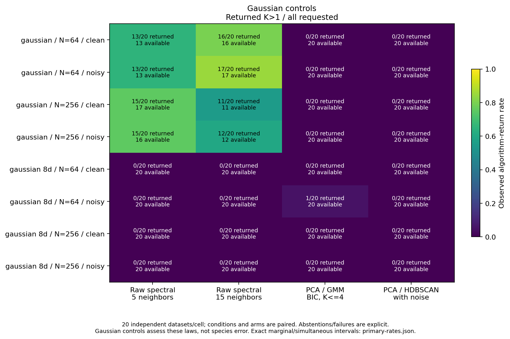
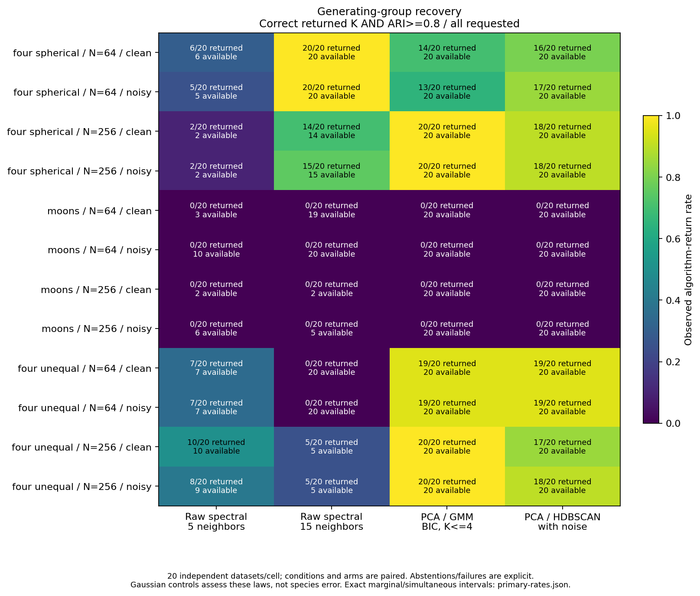

# Fresh unknown-K spectral results

**The frozen largest-eigengap selector is not ready for automatic species
delimitation.** It often splits a single low-dimensional Gaussian population
and never returns the correct two-group count in the tested moons cells.
Separated spherical groups fare better, but do not resolve these failures.
The new CLI/API remains opt-in and experimental; no default or significance
guarantee is promoted.

This completed negative validation followed the [approved frozen protocol](unknown-k-spectral-study.md).
The rule was not changed after outcomes. Existing models/defaults, schemas,
p-values and empirical gates remain unchanged. There was no neural retraining,
resampling, significance testing, empirical fitting or author contact.

## Execution and accounting

The study used 320 fresh independent observations: twenty for each of eight
laws at N=64/256. Paired clean/noisy traits gave 640 eight-feature tables.
Every table was fitted by spectral/eigengap at five and fifteen other neighbors,
unchanged two-PC/full-covariance BIC/GMM and unchanged two-PC/HDBSCAN.
Spectral considered K=1..6 without generating labels; GMM retained K=1..4,
ten starts and its existing size rule.

| Main accounting | Count |
|---|---:|
| Point workflows | 2,560 |
| Exact workflow replays | 32 |
| Total main evaluations | 2,592 |
| Available point results | 2,093 |
| Withheld point results | 467 |
| Numerical/workflow failures | 0 |

All 32 replays matched numerical arrays and decisions exactly. Five-neighbor
spectral returned 322/640 point partitions and withheld 318; fifteen-neighbor
spectral returned 491 and withheld 149. Each baseline returned 640. Withheld
point reasons were search boundaries (199), unsupported disconnected component
counts (148) and numerically unresolved gap choices (120). Including replays,
the audit counted 2,119 available and 473 withheld results.

The separate preflight accounted for 144 workflows and ten marked engineering
timing probes: 154 evaluations and sixteen exact workflow replays. Its audit and
hard resource gate passed, projecting 1.41 GiB evidence and 262.52 seconds for
the main run plus audit. Actual main execution took 131.77 seconds and its audit
46.51 seconds locally. These are not cross-hardware speed guarantees.

## Single-population controls

The rank-two control is a single two-dimensional Gaussian mapped linearly into
eight traits. It contains no generating subgroups. The full-rank control has
eight independent Gaussian traits. The table shows **returned K>1 / all twenty
requested clean datasets**; parentheses give all available results, including K=1.

| Gaussian law / N | Spectral 5 | Spectral 15 | PCA/GMM | PCA/HDBSCAN |
|---|---:|---:|---:|---:|
| Rank two / 64 | 13/20 (13 available) | 16/20 (16) | 0/20 (20) | 0/20 (20) |
| Rank two / 256 | 15/20 (17) | 11/20 (11) | 0/20 (20) | 0/20 (20) |
| Full rank / 64 | 0/20 (20) | 0/20 (20) | 0/20 (20) | 0/20 (20) |
| Full rank / 256 | 0/20 (20) | 0/20 (20) | 0/20 (20) | 0/20 (20) |

Noise did not fix the rank-two problem: fifteen neighbors returned multiple
groups in 17/20 N=64 and 12/20 N=256 observations. Both spectral arms returned
K=1 on every full-rank Gaussian table. GMM had one nontrivial return in the noisy
full-rank N=64 cell. HDBSCAN retained noise and incomplete coverage; one assigned
group does not mean that all units joined it.

For clean rank-two N=64, the fifteen-neighbor nontrivial-return rate was 0.80:
exact marginal 95% interval 0.563–0.943 and simultaneous interval 0.386–0.985
across the frozen family of 128 rates. Four abstentions give potential-outcome
bounds 0.80–1.00. At N=256 the rate was 0.55, with marginal interval 0.315–0.769
and simultaneous interval 0.178–0.884; nine abstentions remain explicit.

These are algorithm-return rates under these laws, not calibrated species
false-positive rates. Their intrinsic-dimension dependence prevents claiming
that merely allowing K=1 solves single-population recognition.

## Recovery and availability

The table reports **correct returned K AND membership ARI>=0.8 / all twenty
requested clean datasets**. Abstentions are not successful returned partitions.
ARI measures agreement with generating membership, not classification accuracy
or species probability.

| Generating law / N | Spectral 5 | Spectral 15 | PCA/GMM | PCA/HDBSCAN |
|---|---:|---:|---:|---:|
| Four spherical / 64 | 6/20 | 20/20 | 14/20 | 16/20 |
| Four spherical / 256 | 2/20 | 14/20 | 20/20 | 18/20 |
| Moons / 64 | 0/20 | 0/20 | 0/20 | 0/20 |
| Moons / 256 | 0/20 | 0/20 | 0/20 | 0/20 |
| Four unequal / 64 | 7/20 | 0/20 | 19/20 | 19/20 |
| Four unequal / 256 | 10/20 | 5/20 | 20/20 | 17/20 |

The fifteen-neighbor spherical N=64 result is encouraging for that law, but
20/20 has simultaneous 95% interval 0.652–1.000 and the same setting performs
poorly on rank-two Gaussian controls. At spherical N=256 it withheld six clean
observations; five neighbors withheld eighteen. High available-only agreement
cannot describe recovery on all twenty inputs.

Both graph settings returned correct K=2 in **0/20 for every moons N/condition
cell**. At clean N=64, fifteen neighbors usually returned four or five groups;
at clean N=256, eighteen requests hit the search boundary and two returned five.
The 0/20 per-cell correct-K interval is 0–0.168 marginally and 0–0.348
simultaneously. A noisy N=64 GMM baseline returned K=2 in ten observations,
but none met the joint membership criterion. Correct count and correct membership
are distinct outcomes.

The earlier [supplied-K diagnostic](spectral-graphs-results.md) demonstrated
membership structure when two groups were supplied. It did not establish K
selection. This fresh study uses different observations, so comparisons with
archival results are unpaired; unknown-K recovery is not confirmed.

## Stress and interpretation

With unequal groups, fifteen neighbors returned three groups on every clean
N=64 input. Five neighbors had better conditional recovery but withheld thirteen
observations. No setting is universally preferred.

Heavy-tailed and continuous-cline laws also produced multiple spectral groups.
They have no discrete reference labels and receive no fictional correct-K or
ARI scores. These are descriptive stress outcomes, not species errors or formal
type-I-error estimates.

The eight-group stress exceeds spectral max_k=6 and GMM max_k=4. Five-neighbor
spectral withheld every observation. Fifteen neighbors returned four or five
groups on all clean N=64 inputs and withheld every clean N=256 input. GMM
returned four; HDBSCAN returned eight on all clean inputs at both N. A boundary
guard cannot detect every underpartition from a restricted search. No expanded
search was run.

HDBSCAN noise is treated as unresolved singletons, with separate assigned-only
agreement and coverage. With one-group truth, any nonconstant full-unit
partition has ARI zero, so Gaussian ARI is not a graded noise-quality measure.
The primary control endpoint is returned K>1 alongside coverage and abstention.

Comparisons change representation (eight raw traits versus two PCs), selection,
search range and noise policy together; they do not isolate one causal mechanism.
Twenty datasets/cell are independent; paired conditions/settings are repeated
measurements. Available-only metrics are conditional, with all-request ARI
bounds and common-available paired denominators. Exact marginal and Bonferroni
intervals concern the frozen 128-rate family under these laws, not general
post-selection or biological validity.

## Verification and next boundary

Independent audits passed input/identity/noise checks, graphs/ties, spectra,
all decisions/abstentions, embedding residuals/projectors, QR assignments,
GMM candidate densities/BIC/eligibility, preprocessing, replay and complete
accounting. Separate post-fit arithmetic checked 2,093 available point
partitions, 128 primary rates and binomial tails, 128 group summaries/bounds,
128 paired comparisons and 64 gap-spectrum aggregates. Audits do not claim a
second complete implementation of the library algorithms.

All 2,302 local scientific tests and 45 focused tests passed. The dependency-light
suite passed 1,529 with 118 optional-dependency skips. Python 3.11/3.12, package
allowlists and installed-workflow checks accompany publication; final master CI
is recorded in the local completion record.
Numerical reference versions are NumPy 2.2.6, SciPy 1.15.3 and scikit-learn 1.6.1.

The [new point workflow](tabular-spectral.md) is a reproducible experimental tool,
**not a recommended automatic species-delimitation method**. Its frozen rule
and guards remain unchanged. The single follow-up proposal is to design and
freeze a single-population-aware group-count criterion on fixed graph inputs
before adding spectral stability or more neural training. No correction is
implemented here.

Only code/docs, invented examples, figures and [small aggregates](../examples/unknown-k-spectral/results/summary.json)
are public. Full inputs, per-unit partitions, graphs, candidates and verification
records remain local under `~/.codex/outputs/super-deli/unknown-k-spectral-20261101/`.
Prior checkouts/artifacts are preserved. Final CI and measured retained bytes are
recorded in the local completion record.
