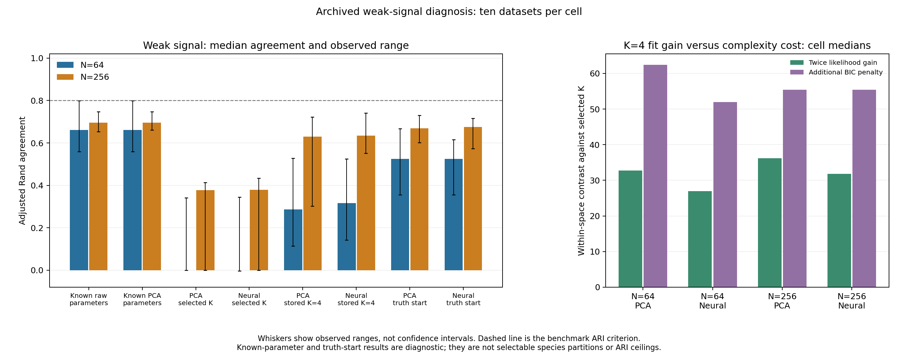

# Weak-signal recovery limits: archival diagnosis

The weak four-group simulations contain substantial overlap. A pointwise
classifier supplied with the true raw-data distributions has expected accuracy
of about 86.9%, and none of the twenty archived weak observations passes the
strict four-group/ARI>=0.8 recovery criterion under that reference. PCA preserves
nearly the same known-law accuracy. BIC favors fewer components, and supplying
the generating partition as a K=4 initialization does not recover the weak groups
to the benchmark criterion. These are complementary diagnostic findings, not a
proof that every possible clustering algorithm is bounded by the reference ARI.

The study preserves existing models, defaults, p-values and empirical gates.
It reuses eighty original observations from the
[completed power study](neural-power-results.md); it adds no independent scientific
datasets, neural training, calibration draws or stability resamples. The
[frozen protocol](weak-signal.md) defines the diagnostic contract.

## Overlap and the distinction between accuracy and partition recovery

The weak law uses complementary shifts of +/-1.5 in two independent, unit-residual
Gaussian latent axes. Morphology supplies one generating-group axis; ecology
supplies the other. Fixed linear maps produce four and eight measured traits,
respectively, with independent feature noise SD 0.15. Means/covariances are known
only because this is a simulation. The reference uses equal marginal class
priors without imposing the generator's known equal realized group counts.

The model-implied expected pointwise correct-assignment fraction is 87.085% in
the latent variables and 86.932% in the raw traits. With the fitted PCA maps
treated as fixed, its median is 86.924% at N=64 and 86.925% at N=256. Thus the
median raw-versus-PCA reference difference is about 0.008 percentage points.
Expected raw-trait accuracy rises to 99.719% at the standard signal and 99.9993%
at the stronger signal, consistent with their much better observed recovery.

| Weak N | Raw-reference observed median accuracy | Raw-reference median ARI | PCA-reference median ARI | Reference recovery, raw/PCA |
|---:|---:|---:|---:|---:|
| 64 | 85.94% | 0.6605 | 0.6605 | 0/10, 0/10 |
| 256 | 87.50% | 0.6964 | 0.6949 | 0/10, 0/10 |

A high individual assignment fraction can coexist with ARI below 0.8: incorrect
memberships alter many specimen pairs. The known-law classifiers use generating
parameters unavailable to ordinary unsupervised analysis, and these realized
ARIs are not mathematical ceilings. The expected-error calculation addresses a
fixed pointwise classifier under the declared law; it does not bound algorithms
using the entire sample or known group capacities. Data-derived PCA maps are
frozen for their diagnostic Gaussian pushforward calculation.

## Representation retains substantial signal in this linear benchmark

The raw traits and PCA reference have very similar known-law performance.
Independent affine-map checks confirm the stored means, standardization, PCA
components and coordinate normalization. In the N=64 weak cell, median linear
recovery R-squared for the two generating axes is approximately 0.9967/0.9980
for PCA and 0.9918/0.9955 for the neural coordinates. Both representations retain
substantial linear signal, while neural coordinates show some additional change.

These are in-sample geometric diagnostics. They do not prove that a nonlinear
encoding loses no information or isolate encoding from a misspecified Gaussian
clustering head. The simulator's linear feature construction makes PCA a strong
reference; the results establish no neural advantage on these data and do not
determine its value on biologically motivated nonlinear inputs.

## Group-count choice and estimated memberships both contribute

At weak signal, K=4 is size-eligible in nine of ten N=64 observations for each
arm and all ten N=256 observations. Most missing four-group selections therefore
cannot be explained by the minimum-size gate. Within each unchanged score space,
the observed likelihood improvement generally does not compensate for the BIC
cost of four components.

| Weak cell | Median twice-log-likelihood gain: K=4 versus selected K | Median additional BIC penalty |
|---|---:|---:|
| N=64, neural | 26.93 | 51.99 |
| N=64, PCA | 32.75 | 62.38 |
| N=256, neural | 31.81 | 55.45 |
| N=256, PCA | 36.18 | 55.45 |

These are separate cell medians, not paired difference estimates. Contrasts use
one coordinate space at a time; no absolute likelihood/BIC is compared across
PCA and neural spaces. Historical Gaussian-departure p-values stay unchanged:
the earlier N=256 9/10 rejection rate did not establish four-group recovery.

Even the stored K=4 candidates recover none of the twenty weak observations per
arm to ARI>=0.8. Generating-label initialization increases median weak-case ARI
but also recovers none: about 0.525 for both N=64 arms, and 0.675 neural/0.669 PCA
at N=256. All forty weak truth-initialized fits are size-eligible, yet none beats
the native selected model's BIC. Improved agreement can accompany lower
likelihood; generating-label agreement is not the likelihood objective.

One separate standard-signal N=64 PCA observation shows an optimization limitation:
a truth-initialized fit reaches ARI=1, improves K=4 log-likelihood by 10.133, and
has BIC 8.725 below the originally selected K=2 fit. This is a supervised
optimization diagnostic, not a deployable repair or a selected alternative.
All other standard/strong recovery cells remain good. This isolated result
prevents claiming that ten ordinary starts always find the best useful optimum;
it does not explain the broad weak-signal limitation.

Bars in the left panel show cell medians; whiskers show observed ranges across
ten archived datasets, not confidence intervals. The dashed line is the fixed
ARI criterion. Known-parameter classifiers and truth-informed fits are visibly
separate diagnostic references. The right panel shows within-space likelihood
and parameter-cost contrasts against each native selected K.

## Controls, uncertainty and boundaries

The original Gaussian controls retain their original point results: each arm
splits one of ten N=64 observations and none of ten N=256 observations. No new
p-value or false-positive calibration is computed. A known one-class reference
returns that supplied class trivially; its perfect accuracy is not an independent
validation of group-count selection. Controls have no four-class truth fit.

Every cell contains ten archived observations. Descriptive exact dataset-level
recovery intervals and requested denominators/failure bounds are retained. A
0/10 recovery rate has marginal 95% upper bound 30.85%; the known-law reference
and multiple methods are paired diagnostic measurements, not new independent
replicates. There is no new hypothesis-test claim or precise general resolution
threshold, and K<=4 cannot assess overpartitioning beyond four.

A targeted follow-up is a separately frozen, biologically motivated nonlinear
matched-view benchmark comparing these unchanged encoders with PCA. This would
test the intended added value of neural integration while retaining the simpler
reference and the limits established here. No follow-up experiment, optimizer
repair, model promotion or default change is implemented in this checkpoint.

## Evidence and verification

All eighty main observations completed. The twenty exact ordinary-head search
replays matched archived scientific arrays/candidates. The 120 isolated K=4
truth-start fits and separate eight-observation preflight completed without
failed fits. This is 200 main plus 28 preflight component-fit calls, with a
maximum 1,092 EM starts across both phases. There were 240 main and 24 preflight
known-parameter reference evaluations, and 640 main plus 64 preflight archived
candidate-density checks. Torch and SNPio imports were blocked throughout the
scientific diagnostic.

Source binding verifies 66,970 prior files and preserves the original power
study's completed head, six CI receipts, source freeze and approved runtime
repair history. All 429 old numerical kernels remain byte-identical; version
and CLI registration are additive exceptions. The 441-file tested source and
separate installed wheel match. Independent audits check raw laws, identities,
affine transformations, frozen neural projections, densities, mixture membership,
likelihood/BIC, eligibility, truth initialization, ARI and report intervals.

Local checks passed 28 diagnostic tests, 1,692 foundation tests and 235 numerical/
integration tests. The invented installed-package fixture passed with two workers
and untrained NumPy encoders. The explicit package allowlist and Python 3.11 syntax
checks passed; final publication requires all six Python 3.11/3.12 CI jobs on the
published head. The measured gate projected 615.34 serial seconds and 260,302,444
bytes of evidence, below thirty minutes and one GiB, with eight GiB free required.

[Public aggregates](../examples/weak-signal/results/) contain only cell summaries,
settings and audit counts. Raw observations, coordinates, fitted parameters,
individual results, complete provenance/CI logs and archives remain local.
See the [export script](../examples/weak-signal/report.py) and
[installed fixture](../examples/weak-signal/smoke.py). No author contact occurred.
